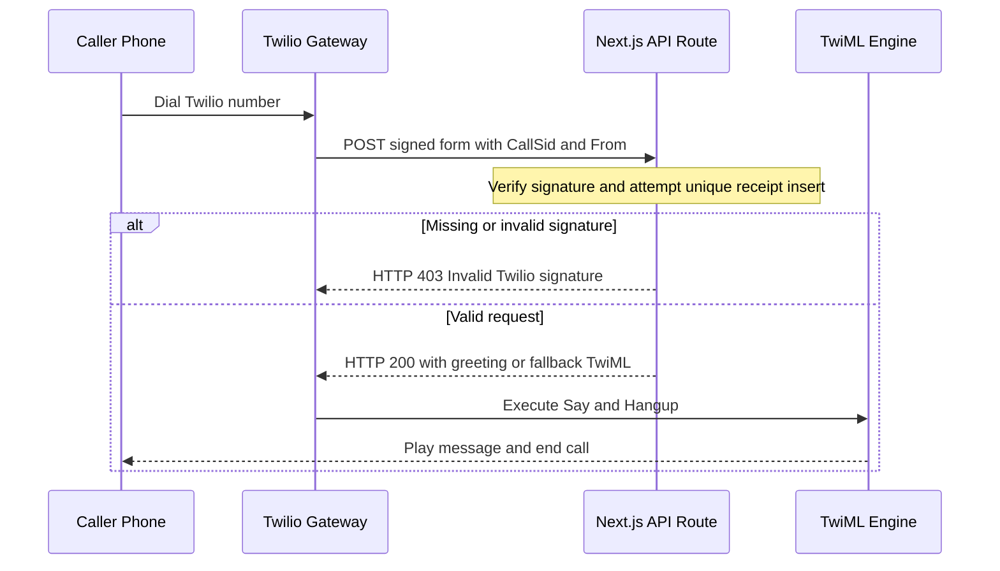

# Telephony Ingestion Pipeline & Security Trace

**Tavia Owens · Neighborhood Listing Platform**

**Implementation:** [Next.js webhook](../src/app/api/twilio/voice/route.ts) and [PostgreSQL migration](../supabase/migrations/20261114000100_twilio_voice_receipts.sql). Verified locally with signed requests and a mock Supabase REST endpoint. A live Twilio call and real PostgreSQL integration are pending.

## 1. Sequence trace



The TwiML engine is part of Twilio. The handler returns TwiML directly.

## 2. Cryptographic signature validation

```ts
  const signature = request.headers.get('X-Twilio-Signature')
  if (!signature) return new Response('Invalid Twilio signature', { status: 403 })

  if (request.headers.get('content-type')?.split(';')[0].trim() !== 'application/x-www-form-urlencoded') {
    return new Response('Expected form-encoded request', { status: 415 })
  }

  const form = new URLSearchParams(await request.text())
  const parameters: Record<string, string[]> = Object.create(null)
  for (const [name, value] of form) (parameters[name] ??= []).push(value)

  if (!twilio.validateRequest(authToken, signature, webhookUrl, parameters)) {
    return new Response('Invalid Twilio signature', { status: 403 })
  }
```

The verified header is `X-Twilio-Signature`. The SDK uses the configured public URL and form parameters to validate the Base64 HMAC-SHA1 signature using `TWILIO_AUTH_TOKEN`, loaded from `.env.local` locally or the host's environment in production. The URL is read from `TWILIO_VOICE_WEBHOOK_URL`. Missing or invalid signatures on the supported form route return HTTP **403** with the exact body `Invalid Twilio signature`. See [Twilio webhook security](https://www.twilio.com/docs/usage/webhooks/webhooks-security).

## 3. Idempotency

`CallSid` is the identifier for this incoming-call endpoint. PostgreSQL enforces uniqueness with `call_sid` as the primary key. The Supabase upsert uses `ignoreDuplicates: true` and `onConflict: 'call_sid'`, so concurrent retries cannot create another receipt. The duplicate receives the same greeting TwiML. The receipt is the only database write this handler performs.

## 4. PII and safe logging

```ts
    console.info('twilio_voice', { event: data.length ? 'accepted' : 'duplicate' })
```

```ts
    console.error('twilio_voice', { event: 'receipt_write_failed' })
```

The handler logs only fixed event labels. It omits `From`, transcript text, `CallSid`, request bodies, and exception details from application logs. PostgreSQL stores the validated `CallSid` and a receipt timestamp. The synthetic test verified that the caller number, transcript, and SID were absent from captured process logs.

## 5. Safe fallback TwiML

A database error or timeout returns HTTP **200** with `Content-Type: text/xml; charset=utf-8` and the following body.

```xml
<?xml version="1.0" encoding="UTF-8"?><Response><Say>We are temporarily unable to take your call. Please try again later.</Say><Hangup/></Response>
```

## Live setup

1. Apply the receipt-table migration to the project's Supabase database.
2. Deploy the branch to a public HTTPS host. Set server environment variables `SUPABASE_URL`, `SUPABASE_SERVICE_ROLE_KEY`, `TWILIO_AUTH_TOKEN`, and `TWILIO_VOICE_WEBHOOK_URL`. Use the full public route URL for the last setting.
3. In Twilio, configure the number's incoming Voice webhook to POST to that exact URL and place a test call. Verify the greeting, the receipt, and the event-only logs.

The production build and ESLint passed. The local HTTP test passed missing and invalid signature checks, concurrent signed retry behavior against the mock, fallback XML after a forced database error, and the PII log check.
